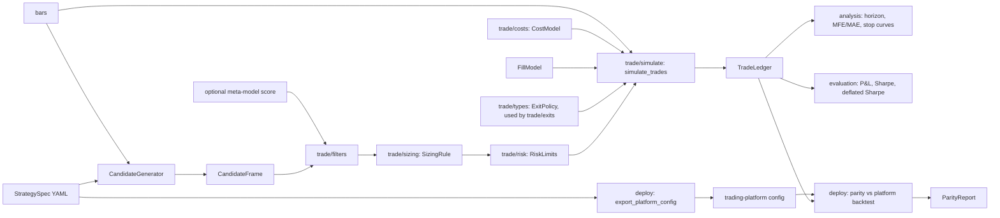

# Architecture

This page describes the target layout of `src/shpe_research/` and the repo
around it, the import rules between layers, and how data flows from bars to a
deployable strategy. It also maps the current tree to the target tree file by
file.

The decisions behind it are recorded in the ADRs:
[0002](../adr/0002-layered-package-structure.md) (layers and imports),
[0003](../adr/0003-pipeline-stages-and-registries.md) (pipeline stages),
[0004](../adr/0004-events-candidates-unit-of-decision.md) (events),
[0005](../adr/0005-strategies-and-shared-trade-toolkit.md) (strategies and trade).
Exact function signatures live in the task packets in
[handoff/tasks/](../handoff/tasks/), not here.

Related design pages: [pipeline.md](pipeline.md), [trade-layer.md](trade-layer.md),
[platform-parity.md](platform-parity.md), [testing.md](testing.md).

## Principles

1. **Contracts first.** Every layer exchanges data through the frames defined in
   [contracts.md](../contracts.md): bars, ticks, `Dataset`, `ModelManifest`.
   New frames (`CandidateFrame`, `TradeLedger`) get a contract and a validator
   before anything consumes them.
2. **Registries, not if-chains.** Configs name things by registry key
   (`{type: past_return, window: 5}`). Code registers them with a decorator.
   Adding a feature, model, label, sampler, strategy or fit scheme never edits
   the runner.
3. **Lower layers never import higher ones.** The rule is checked in CI by
   import-linter (C1l), not by review.
4. **Library code is shared; study code is not.** Anything a second study could
   use goes in `src/shpe_research/`. A study folder holds configs, a README and
   figures.
5. **Research mirrors the platform.** Fills, exits, sizing and risk use the
   platform's rules and names so a research result can be exported and checked
   (see [platform-parity.md](platform-parity.md)).

## Package tree (target)

```
src/shpe_research/
  config.py                  paths, env, git commit; Pydantic config models (C1h)
  contracts/                 frame schemas and validators; no internal imports
    base.py  bars.py  ticks.py  dataset.py  model.py  version.py
    candidates.py            CandidateFrame column schema (stub in C1a, filled by C1b)
  data/
    sources/                 pluggable sources (C1g): alpaca, file, fred, edgar
    alpaca.py  bars.py  ticks.py  store.py  jobs.py  ratelimit.py
    calendar.py  audit.py  corporate_actions.py  universe.py  snapshot.py
    security_master.py       point-in-time listings, symbol changes, delistings (C1m)
    fixtures.py              synthetic bars with planted effects (C1o)
  features/                  per-symbol Feature classes, grouped by theme
    base.py                  Feature, @register_feature, compute_features, assert_no_lookahead
    returns/                 past_return, daily returns, 12-1 momentum inputs
    session/                 minute_of_day, minutes_since_open, opening range
    volume/                  relative_volume, vwap_distance
    volatility/              realized_vol, range-based estimators
    microstructure/          signed_volume_ratio and other tick-summary features (F6)
    cross_asset/             market_return (F8), pair_spread_z (F7)
    regime/                  variance ratio, autocorrelation, efficiency ratio (F5)
  transforms/                cross-sectional: rank, z-score, winsorize, neutralize (C1d)
  events/                    generic event generators -> CandidateFrame (C1b)
  labels/                    @register_label; forward_return, multi_horizon, triple_barrier (C1c)
  trade/                     shared trade toolkit (T1-T5)
    exits.py  simulate.py  sizing.py  filters.py  risk.py  costs.py
  validation/                splits.py, purged.py; fit-scheme splitters (C1f, V1)
  models/                    Model subclasses, @register_model, export_onnx.py (M3)
  evaluation/                report sections, trading metrics (E1), stats (E2)
  analysis/                  trade diagnostics: horizon curve, OU half-life, MFE/MAE (T6)
  strategies/                team-owned families, @register_strategy, StrategySpec (S*, T8)
    spec.py                  StrategySpec (Pydantic) and CandidateGenerator protocol
    momentum/                orb.py, ema_cross.py, xs_momentum.py (SM1-SM3)
    reversal/                bar_fade.py, stretch.py, residual.py (SR1-SR3)
    statarb/                 selection.py, hedge.py, ou.py, pairs.py (SS1-SS4)
  portfolio/                 signal combination, neutralization, weights (workshop example 8)
  pipeline/                  stages, @register_sampler, @register_fit_scheme, run manifests (C1a)
  deploy/                    platform_config.py (export_platform_config), parity.py (ParityReport) (T7)
  experiments/               runner.py (thin wrapper over pipeline/), sweep.py (M2), sources.py
  testing/                   check_feature, check_model, check_label, check_strategy (C1k)
  scaffold/                  `shpe new feature|model|strategy|study` templates (C1j, T8)
  cli.py                     `shpe` entry point
```

Notes on the tree:

- `features/` subpackages are for humans. Configs use registry keys, so moving
  a class between files never changes a config.
- `transforms/` works across symbols at one timestamp. `features/` works on one
  symbol's history. Keeping them apart keeps `assert_no_lookahead` simple: it
  only has to check per-symbol computations.
- `events/` holds generic decision-point generators (every N minutes, session
  open, threshold crossing, CUSUM filter). Strategy-specific generators (ORB
  breakout, pairs z-score entry) live in `strategies/` and return the same
  `CandidateFrame`.
- `trade/` sits low in the stack because `labels/triple_barrier` uses
  `trade/simulate` (see [trade-layer.md](trade-layer.md)).
- The `CandidateFrame` column schema lives in `contracts/candidates.py`
  because `trade/` (rank 3) consumes it and `events/` (rank 4) produces it.
  `events/types.py` defines the `CandidateGenerator` protocol and re-exports
  `CandidateFrame`, so both import paths work. `ExitPolicy`, `FillModel`,
  `TradeLedger`, `SizingRule`, `RiskLimits` and `CostModel` live in
  `trade/types.py`, as the handoff packets list them.
- `testing/` is shipped in the package so studies and workshop notebooks can
  call the check kits. Library code never imports it.

## Repo tree (target)

```
configs/
  experiments/               one YAML per run (existing)
  sweeps/                    sweep grids for M2
  universe/                  universe definitions and candidate lists (existing)
  feature_sets/              named feature lists reused by several experiments
  strategies/                StrategySpec YAMLs, one per strategy variant
studies/
  README.md
  momentum/                  r1-orb-selectors/, rm1-.../
  reversals/                 r2-reversal-metalabel/, r4-microstructure-ofi/, rr1-.../
  stat-arb/                  r3-pairs-clustering/, rs1-.../
  shared/                    r5-tca/
workshop/
  NN_slug/                   jupytext .py notebook + data notes, one folder per example (W0-W9)
tests/
  unit/                      one module per library module; fast, no I/O beyond tmp_path
  integration/               end-to-end runs on the fixture; CLI; snapshot round trips
  workshop/                  executes every workshop notebook on the fixture (W0)
  todo/                      skipped acceptance tests for open tasks (existing)
docs/
  README.md                  documentation map and canonical IDs
  design/  adr/  research/  teams/  handoff/  workshop/
mkdocs.yml                   docs site (C1n)
AGENTS.md  CLAUDE.md         agent rules
.claude/agents/              specialised agent definitions
```

Study folder naming is `studies/<team>/<id>-<slug>/`, for example
`studies/momentum/r1-orb-selectors/`. New team studies use `RM<n>`, `RR<n>` and
`RS<n>` (see [docs/README.md](../README.md#studies)).

## Layers and import rules

Each layer may import from layers below it, never from layers above. Siblings
on one line are independent: they may not import each other.

| Rank | Layer (siblings are independent) | May import |
|---|---|---|
| 8 | `cli` | everything below |
| 7 | `experiments`, `scaffold` | ranks 1-6 |
| 6 | `pipeline`, `deploy`, `testing` | ranks 1-5 |
| 5 | `strategies`, `portfolio`, `analysis` | ranks 1-4 |
| 4 | `evaluation`, `models`, `validation`, `events`, `labels` | ranks 1-3 |
| 3 | `features`, `transforms`, `trade` | ranks 1-2 |
| 2 | `data` | rank 1 |
| 1 | `contracts`, `config` | standard library and third-party only |

Why some placements are not obvious:

- **`trade` at rank 3.** `labels/triple_barrier` (rank 4) calls
  `trade/simulate.simulate_trades`. One fill implementation serves both labels
  and backtests.
- **`events` above `features`.** A CUSUM or threshold event reads feature
  columns. Features never know about events.
- **`analysis` above `evaluation`.** Trade diagnostics reuse
  `evaluation/stats.block_bootstrap`. Evaluation never needs a trade ledger.
- **`pipeline` above `strategies`.** The pipeline consumes a `CandidateFrame`
  from either `events/` or a registered strategy.
- **`deploy` above `strategies`.** Export reads a `StrategySpec` and a
  `TradeLedger`. Strategies never import deploy code.
- **`testing` at rank 6.** The check kits exercise features, labels, models and
  strategies. A `forbidden` contract stops any non-test module from importing
  `shpe_research.testing`.

Additional contracts:

- **Team independence.** `strategies.momentum`, `strategies.reversal` and
  `strategies.statarb` are independent. Code two teams need moves down into
  `trade/`, `features/` or `analysis/`.
- **Contracts are leaves.** `shpe_research.contracts` imports nothing else from
  `shpe_research`.
- **No notebooks or studies in the package.** `studies/` and `workshop/` are not
  packages and are never imported by `src/`.

### import-linter configuration (C1l)

The CI job runs `uv run lint-imports`. The contracts in `pyproject.toml` look
like this; the C1l packet holds the final version.

```toml
[tool.importlinter]
root_package = "shpe_research"

[[tool.importlinter.contracts]]
name = "Layered architecture"
type = "layers"
layers = [
    "cli",
    "experiments | scaffold",
    "pipeline | deploy | testing",
    "strategies | portfolio | analysis",
    "evaluation | models | validation | events | labels",
    "features | transforms | trade",
    "data",
    "contracts | config",
]

[[tool.importlinter.contracts]]
name = "Team strategy families are independent"
type = "independence"
modules = [
    "shpe_research.strategies.momentum",
    "shpe_research.strategies.reversal",
    "shpe_research.strategies.statarb",
]

[[tool.importlinter.contracts]]
name = "Library code does not import the test kits"
type = "forbidden"
source_modules = [
    "shpe_research.pipeline",
    "shpe_research.deploy",
    "shpe_research.strategies",
    "shpe_research.experiments",
]
forbidden_modules = ["shpe_research.testing"]
```

The `|` separator for independent siblings needs import-linter 2.x. If the
version in use does not support it, split each line into separate layers and
add `independence` contracts for the siblings.

## Data flow

### Research pipeline

```mermaid
flowchart LR
    subgraph data[data]
        SRC[sources: alpaca, file, fred, edgar] --> STORE[(Parquet store)]
        STORE --> SNAP[snapshot / fixture]
        SM[security_master] --> UNIV[point-in-time universe]
    end
    SNAP --> BARS[bars contract]
    UNIV --> BARS
    BARS --> FEAT[features: per symbol]
    FEAT --> XS[transforms: cross-sectional]
    BARS --> EV[events or strategy CandidateGenerator]
    XS --> EV
    EV --> CAND[CandidateFrame]
    CAND --> SAMP[sampler]
    BARS --> LAB[label registry]
    SAMP --> JOIN[join at decision_ts]
    XS --> JOIN
    LAB --> JOIN
    JOIN --> DS[Dataset: X, y, meta with era]
    DS --> FIT[fit scheme: single, walk-forward, purged]
    FIT --> MOD[Model.fit / predict]
    MOD --> PRED[predictions]
    PRED --> EVAL[evaluation: IC, deciles, costs, deflated Sharpe]
    EVAL --> RUN[(runs/stamp-name/)]
```



### Strategy and trade flow



The two flows meet at the `CandidateFrame`. A meta-labeling study (R1, R2,
workshop example 4) takes a strategy's candidates, labels them with
`triple_barrier` (which runs `simulate_trades`), fits a model, and feeds the
score back into `trade/filters` as a take/skip gate.

## Why this layout

The layout copies structures that have held up in public quant tooling and in
the published research-process literature. It is not novel, which is the point:
new members can map it onto things they have read.

| Source | What it contributes | Where it shows up here |
|---|---|---|
| Qlib (Microsoft) | Separation of data handler, model and "record" stages; every run writes a recorded artifact set | `pipeline/` stages; `runs/<stamp>-<name>/` with config, manifest, predictions, report |
| Zipline Pipeline (Quantopian) | Factors computed per asset, then cross-sectional screens and ranks evaluated at one timestamp | `features/` (per symbol) vs. `transforms/` (cross-section) |
| Alphalens (Quantopian) | Factor tear sheet: IC by period, quantile returns, turnover | `evaluation/report.py` deciles and daily IC; E1 adds turnover and decay |
| Numerai | Eras as the unit of cross-validation and of reporting; feature neutralization | `era` column in `Dataset.meta`; by-era report (C1i); `transforms/neutralize` |
| López de Prado, *Advances in Financial Machine Learning* (2018) | Triple-barrier labels, meta-labeling, purged k-fold with embargo, deflated Sharpe | `labels/triple_barrier`, `validation/purged.py`, `evaluation/stats.py` |
| Bailey and López de Prado (2014), "The Deflated Sharpe Ratio" | Correct the Sharpe ratio for the number of trials | E2 `deflated_sharpe`; trial counting in [research-protocol.md](../research/research-protocol.md) |

### The industry flow

Most systematic equity desks describe their process as the chain below. Each
step maps to one package, so a gap in the chain shows up as an empty folder
rather than as logic hidden in a notebook.

| Step | What happens | Package |
|---|---|---|
| Point-in-time data | Bars, ticks, universe and listings as known at the time | `data/`, `data/security_master.py` |
| Signal | Per-asset features and strategy candidates | `features/`, `events/`, `strategies/` |
| Normalize | Cross-sectional rank, z-score, winsorize | `transforms/` |
| Combine | Blend signals or fit a model on them | `models/`, `portfolio/` |
| Risk | Neutralize exposures; apply limits | `transforms/neutralize`, `trade/risk.py` |
| Construct | Turn scores into positions and sizes | `portfolio/`, `trade/sizing.py` |
| Execute | Simulate fills with platform rules and costs | `trade/simulate.py`, `trade/costs.py` |
| Attribute | Explain P&L by trade, era, group and cost | `analysis/`, `evaluation/` |

This flow is a description of common practice, not a claim that any particular
firm runs exactly this code.

## Migration: current tree to target tree

Moves change import paths but not registry keys, so configs keep working. Do
the moves in one PR before parallel work starts, so every worktree branches
from the new tree. The [handoff README](../handoff/README.md) assigns the PR and
its merge position.

### Source files

| Current | Target | Notes |
|---|---|---|
| `contracts/*` | `contracts/*` | Unchanged. Add `candidates.py` (CandidateFrame schema; C1a stub, C1b) |
| `config.py` | `config.py` | Gains Pydantic config models (C1h) |
| `data/*` | `data/*` | Unchanged. Add `data/sources/` (C1g), `security_master.py` (C1m) |
| `features/base.py` | `features/base.py` | Unchanged |
| `features/returns.py` (`PastReturn`) | `features/returns/past_return.py` | Key `past_return` |
| `features/returns.py` (`MinuteOfSession`, `minutes_since_open`) | `features/session/minute_of_session.py` | Key stays `minute_of_day` |
| `features/opening_range.py` | `features/session/opening_range.py` | Keys `or_width`, `or_breakout_dist` |
| `features/relative_volume.py` | `features/volume/relative_volume.py` | F1 |
| `features/vwap_distance.py` | `features/volume/vwap_distance.py` | F2 |
| `features/realized_vol.py` | `features/volatility/realized_vol.py` | F3 |
| `features/regime.py` | `features/regime/regime.py` | F5 |
| `features/order_flow.py` | `features/microstructure/order_flow.py` | F6 |
| `features/cross_asset.py` (`MarketReturn`) | `features/cross_asset/market_return.py` | F8 |
| `features/cross_asset.py` (`PairSpreadZScore`) | `features/cross_asset/pair_spread.py` | F7; see the note below on shared pair math |
| `labels/forward_return.py` | `labels/forward_return.py` | Registered with `@register_label` (C1c) |
| `labels/multi_horizon.py` | `labels/multi_horizon.py` | L1; registered |
| `labels/exit_policy.py` (`ExitPolicy`) | `trade/types.py` (dataclass); exit logic in `trade/exits.py` | T1 absorbs L2 |
| `labels/exit_policy.py` (`simulate_exits`) | `trade/simulate.py` (`simulate_trades`) | T1 |
| — | `labels/triple_barrier.py` | New; wraps `simulate_trades` (C1c) |
| `validation/splits.py`, `purged.py` | same | V1; wrapped as fit schemes (C1f) |
| `models/*` | same | Model classes unchanged |
| `evaluation/*` | same | C1i adds report sections |
| `experiments/runner.py` | `pipeline/` + thin `experiments/runner.py` | `build_dataset` splits into pipeline stages (C1a) |
| `experiments/sources.py` | `data/sources/` registry; `experiments/sources.py` re-exports during the transition | C1g |
| `experiments/sweep.py` | same | M2 |
| `cli.py` | same | Gains `shpe new` (C1j) and `shpe export` (M3, T7) |

The F7 feature needs a hedge ratio and a half-life, and so do SS2 and SS3.
`strategies/` (rank 5) may import `features/` (rank 3) but not the reverse, so
the shared estimators live at the feature level (for example
`features/cross_asset/pair_math.py`) and `strategies/statarb/hedge.py` and
`ou.py` import them and add the strategy-only variants (Kalman, TLS). The SS2
and SS3 packets fix the exact split.

### Repo files

| Current | Target |
|---|---|
| `studies/r1-orb-selectors/` | `studies/momentum/r1-orb-selectors/` |
| `studies/r2-reversal-metalabel/` | `studies/reversals/r2-reversal-metalabel/` |
| `studies/r3-pairs-clustering/` | `studies/stat-arb/r3-pairs-clustering/` |
| `studies/r4-microstructure-ofi/` | `studies/reversals/r4-microstructure-ofi/` |
| `studies/r5-tca/` | `studies/shared/r5-tca/` |
| `docs/workshop.md` | `docs/workshop/README.md` and `docs/workshop/sessions/` |
| `tests/test_contracts.py`, `test_calendar.py`, `test_audit.py`, `test_ticks.py`, `test_universe.py`, `test_snapshot.py`, `test_package.py` | `tests/unit/` (same names) |
| `tests/test_pipeline.py`, `test_bars_download.py` | `tests/integration/` |
| `tests/conftest.py`, `tests/fake_alpaca.py` | `tests/conftest.py`, `tests/fakes/fake_alpaca.py` |
| `tests/todo/*` | `tests/todo/*` (unchanged; files leave as tasks land) |
| — | `tests/workshop/` (W0) |
| — | `configs/sweeps/`, `configs/feature_sets/`, `configs/strategies/` |
| — | `workshop/NN_slug/` (W0-W9) |
| — | `mkdocs.yml` (C1n) |
