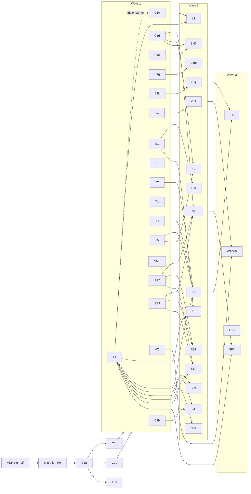

# Implementation handoff

This folder splits the toolkit build into packets that people or coding agents
can work on at the same time, each in its own git worktree. Every task ID here
is defined in [../README.md](../README.md). The task board
([../tasks.md](../tasks.md)) has one row per task and links to its packet in
[tasks/](tasks/).

Read this page once before claiming a task, then read only your packet. A
packet lists everything you need: the files you own, the interface to build,
the behaviour, the acceptance tests, and what is out of scope.

## How parallel work is organised

### One worktree per task

Each task gets its own worktree and branch, named as in
[CONTRIBUTING.md](../../CONTRIBUTING.md) (`<your-name>/<task id>`):

```
git fetch origin
git worktree add ../rp-<ID> -b <your-name>/<ID> origin/main
cd ../rp-<ID>
uv sync --all-extras
uv run pytest            # must be green before you start
```

Remove it after the merge with `git worktree remove ../rp-<ID>`. Never run two
tasks in one worktree, and never share a branch between tasks.

Claim a task the usual way before starting: open an issue titled
`<task id>: <task name>`, assign yourself, and set its row in
[../tasks.md](../tasks.md) to `Claimed (<name>)` in your first PR (or ask the
lead to).

### Exclusive ownership

Each packet has an **Owns** list. Only that task creates or edits those files
until it merges. A file appears in the Owns list of exactly one open task. If
you need a change in a file you do not own:

1. If it is a hotspot below, follow that hotspot's rule.
2. Otherwise, open an issue against the owning task and work around it (a
   local helper, a skipped test with the issue number). Do not edit the file.

**Reads** lists files you depend on but must not change.

### Conflict hotspots

These files are touched by many tasks. Each has one owner, and everyone else
follows the edit rule.

| File | Owner | Rule for everyone else |
|---|---|---|
| `pyproject.toml` | Lead in Wave 0 (with C1l) | Wave 0 adds every dependency the packets name (see below). Afterwards a task may append **one line per new dependency** to an existing list and must say why in the PR. Never reorder or reformat. The `[tool.importlinter]` section belongs to C1l. |
| `src/shpe_research/features/__init__.py` | C1a sets the pattern | Registration only: add one import line and one `__all__` entry, kept alphabetical. No other edits. |
| `src/shpe_research/models/__init__.py` | C1a | Registration only, as above. |
| `src/shpe_research/labels/__init__.py` | C1c | Registration only after C1c merges. Before that, only C1c edits it. |
| `src/shpe_research/strategies/__init__.py` and `strategies/{momentum,reversal,statarb}/__init__.py` | C1a creates them empty; the first packet of each team fills the pattern (SM1 for `momentum/`, SR1 for `reversal/`, SS2 for `statarb/`) | Registration only: one import line per module, alphabetical. Package names are singular `reversal` and `statarb`, while team folders under `studies/` and `docs/teams/` are `reversals` and `stat-arb`. |
| `src/shpe_research/features/cross_asset/pair_math.py` | The migration PR creates it empty; SS2 owns the hedge-ratio functions, SS3 the OU functions | SS2 and SS3 each append under their own section header and never edit the other's. Whoever merges second keeps both blocks. F7-F8 and `strategies/statarb/` only import from it. |
| `src/shpe_research/portfolio/__init__.py` | C1a creates it; T9 fills it | Registration only after T9 merges. |
| `src/shpe_research/pipeline/registry.py` (sampler, label, fit scheme, report section registries) | C1a | Nobody else edits it. Register with the decorators from your own module. |
| `src/shpe_research/experiments/runner.py` | C1a | Nobody else edits it. After C1a the runner dispatches through registries, so new samplers, labels, fit schemes and report sections plug in without touching it. |
| `src/shpe_research/config.py` and `strategies/spec.py` | C1h | Nobody else edits them. A new config field is a request to C1h (Wave 0) or, after C1h merges, a one-field PR reviewed by the lead. |
| `src/shpe_research/data/fixtures.py` | C1o | Nobody else edits it. If your test needs a planted effect the fixture lacks, open an issue against C1o. |
| `src/shpe_research/cli.py` | C1a; C1j adds `shpe new` | Registration only: one `_add_<group>(sub)` call plus the group's own function in your own module. |
| `tests/conftest.py` | C1o | Registration only: append a fixture function. Do not change existing fixtures. |
| `docs/contracts.md` | C1d (context-symbol bump); otherwise lead | Contract changes need the lead's review and a `CONTRACT_VERSION` bump in `contracts/version.py`. |
| `docs/tasks.md` | Lead | Each PR changes only its own row's Status cell. |

Dependencies, so later tasks rarely touch `pyproject.toml`:

| Dependency | Where | Added by | Needed for |
|---|---|---|---|
| `pydantic` | `dependencies` | Lead, Wave 0 | C1h |
| `scipy` | `dependencies` | Lead, Wave 0 | Already imported by `data/fixtures.py` but not listed; SS1–SS3 |
| `statsmodels` | `dependencies` | Lead, Wave 0 | SS1–SS3 (cointegration, ADF), W5 |
| `scikit-learn` | `dependencies` | already listed | W3 (`ridge`, `ridge_reg`), SS1 clustering, M1a |
| `import-linter` | `dev` group | Lead, Wave 0 (C1l owns `[tool.importlinter]`) | C1l |
| `mkdocs-material`, `mkdocstrings[python]` | `docs` group | Lead, Wave 0 | C1n |
| `jupytext`, `jupyterlab` | `workshop` group | W0 (its one `pyproject.toml` edit) | W0–W9 |
| `torch` | `nn` extra | already listed | M1c; the optional LSTM cell in W2 (`uv sync --extra nn`) |
| `lightgbm`, `onnx`, `skl2onnx`, `onnxruntime`, `mlflow` | `ml` extra | already listed | M1b, M2, M3, W2–W9 |

### Shared types land in Wave 0

Parallel work only holds if every task codes against the same type names. C1a
and C1h create these as stubs with their final names, fields and docstrings,
before Wave 1 starts. Later tasks fill in behaviour and never rename them.

| Name | Module (created by) | Filled in by |
|---|---|---|
| `register_feature`, `register_model` | existing | |
| `register_label`, `register_sampler`, `register_fit_scheme`, `register_report_section` | `pipeline/registry.py` (C1a) | C1a |
| `register_strategy` | `strategies/registry.py` (C1a) | C1a |
| `CandidateFrame`, `CANDIDATE_COLUMNS`, `validate_candidates` | `contracts/candidates.py` (C1a) | C1b |
| `CandidateGenerator` (protocol; re-exports `CandidateFrame`) | `events/types.py` (C1a) | C1b |
| `ExitPolicy`, `FillModel`, `TRADE_LEDGER_COLUMNS`, `TradeLedger` | `trade/types.py` (C1a) | T1 |
| `simulate_trades` | `trade/simulate.py` (C1a stub) | T1 |
| `SizingRule` | `trade/types.py` (C1a) | T2 |
| `RiskLimits` | `trade/types.py` (C1a) | T4 |
| `CostModel` | `trade/types.py` (C1a) | T5 |
| `scores_to_weights`, `neutralize_weights`, `rebalance`, `portfolio_returns` | `portfolio/construct.py` (T9) | T9 |
| `StrategySpec` | `strategies/spec.py` (C1h) | C1h |
| `export_platform_config`, `ParityReport`, `compare_ledgers` | `deploy/platform_config.py`, `deploy/parity.py` (C1a stubs) | T7 |
| Model keys `ridge`, `ridge_reg`, `identity` | `models/ridge.py`, `models/identity.py` | W3 |

`trade/` imports `contracts/` and never `events/`; that is why `CandidateFrame`
lives in `contracts/candidates.py` and `events/types.py` only re-exports it.
FillModel defaults are 2 bps half-spread, 5 bps slippage and $0.005 per share,
matching the platform; T1 has the fill rules.

The design behind these names is in [../design/trade-layer.md](../design/trade-layer.md)
and [../design/pipeline.md](../design/pipeline.md); the layer rules are in
[../design/architecture.md](../design/architecture.md) and the ADRs in
[../adr/](../adr/).

## Waves

A wave is the earliest point a task can start: all of its dependencies have
merged to `main`. Tasks inside a wave run in parallel. A task does not have to
wait for its whole wave, only for its own dependencies.

- **Wave 0 (lead, serial).** ADR sign-off, then the **migration PR** (below),
  then C1a, then C1h, C1o and C1l in parallel, and the `pyproject.toml`
  dependency pass. Nothing else starts until the migration PR, C1a and C1o
  merge, because every packet's paths, shared types and tests depend on them.
- **Wave 1 (parallel on the fixture).** Library foundations, the trade
  toolkit, SM2, SS2, SS3, W0, and the existing F1–F6, L1, V1, E1, E2 and M
  tasks.
- **Wave 2.** Tasks that need a Wave 1 result: fit schemes, report upgrades,
  scaffolding framework, F7/F8, L2, T6, T7, T9 and the simulator-based
  strategies.
- **Wave 3.** Tasks that need several Wave 2 results: T8, SR3, the docs site
  and all workshop examples W1–W9.

### Wave 0: the migration PR

Owner: the lead. It merges before C1a and before anyone creates a worktree,
so every branch starts from the target tree in
[../design/architecture.md](../design/architecture.md#migration-current-tree-to-target-tree).
It moves files and fixes imports; it changes no behaviour and no registry key.

Checklist:

- [ ] Feature files moved to their subpackages per the migration table:
      `features/returns/past_return.py`, `features/session/minute_of_session.py`,
      `features/session/opening_range.py` (F4), `features/volume/relative_volume.py`
      (F1), `features/volume/vwap_distance.py` (F2),
      `features/volatility/realized_vol.py` (F3), `features/regime/regime.py` (F5),
      `features/microstructure/order_flow.py` (F6).
- [ ] `features/cross_asset.py` split into `features/cross_asset/market_return.py`
      (F8) and `features/cross_asset/pair_spread.py` (F7), plus an empty
      `features/cross_asset/pair_math.py` with one section header each for
      SS2 and SS3.
- [ ] Every stub keeps its `TODO(<ID>)` docstring word for word; registry keys
      and column names unchanged; `features/__init__.py` imports updated.
- [ ] Tests moved to `tests/unit/`, `tests/integration/` and `tests/fakes/` per
      the repo-files table; `tests/todo/` unchanged.
- [ ] Study folders moved to `studies/<team>/<id>-<slug>/` (R1 to `momentum/`,
      R2 and R4 to `reversals/`, R3 to `stat-arb/`, R5 to `shared/`).
- [ ] `docs/workshop.md` moved as the repo-files table says, without
      overwriting files the workshop writers have already put in
      `docs/workshop/`.
- [ ] `uv run pytest` passes with the same number of passed and skipped tests
      as before, and the hello-model golden output is unchanged.



The graph shows only the edges that decide the wave. Each packet lists its full
**Depends on**. The dashed edge means C1c starts in Wave 1, but its
`triple_barrier` label waits for T1.

## Merge order and rebasing

1. The migration PR merges first, then C1a, then C1h, C1o and C1l. Worktrees
   are created only after that.
2. Within a wave, merge in the order PRs become green and reviewed. There is no
   fixed order, because Owns lists do not overlap.
3. Before requesting review, rebase on `main`
   (`git fetch origin && git rebase origin/main`) and re-run `uv run ruff check`
   and `uv run pytest`.
4. Hotspot conflicts are resolved by keeping both sides (two import lines, two
   dependency lines, two `pair_math.py` sections). Any other conflict means two
   tasks touched the same file; stop and ask the lead which task owns it.
5. Packets that change shared behaviour merge before the packets that consume
   it: C1a before everything; T1 before C1c's `triple_barrier`; C1c before L2;
   V1 before C1f; T1 before any S task that runs trades; C1d, SS2 and SS3
   before F7/F8; SS2 before SS3 when both are ready (SS2 fills
   `strategies/statarb/__init__.py`).
6. If your dependency has an open PR but has not merged, you may branch from
   its branch to start, but rebase onto `main` once it merges and before your
   own review. Never merge a PR whose base is another task's branch.

## Definition of done (every packet)

A packet is done when all of these hold:

- Its acceptance tests exist at the paths the packet names, are not skipped,
  and pass. Any `tests/todo/` test the packet names has had its skip marker
  removed (and moved out of `tests/todo/` if the packet says so).
- `uv run ruff check` and `uv run pytest` pass on the rebased branch, and the
  import-linter contracts pass once C1l has merged (`uv run lint-imports`).
- Every new feature, label or candidate generator passes the matching check
  kit from C1k once it has merged (`check_feature`, `check_label`,
  `check_strategy`), and `assert_no_lookahead` for features in any case.
- No file outside the packet's Owns list changed, except hotspot edits that
  follow the rules above.
- `TODO(<ID>)` markers for this task are gone; any work left for later is a new
  `TODO(<other ID>)` with an issue.
- Public functions and classes have docstrings that state units, timestamps
  (`ts`, `ts_available`, `decision_ts`) and what happens on missing data.
- The task's row in [../tasks.md](../tasks.md) is set to Done in the merge.
- Someone other than the author reviewed it. Leakage-sensitive packets (labels,
  validation, features, candidate generators, the simulator) also get a review
  pass with the `leakage-auditor` agent or a person acting in that role.

## Briefing a coding agent

Each packet names a recommended agent from [../../.claude/agents/](../../.claude/agents/).
Open the worktree, start the agent in it, and paste this prompt with the
placeholders filled in:

```
You are working in the git worktree for task <ID> on branch <your-name>/<ID>.
Use the <agent-name> agent definition in .claude/agents/<agent-name>.md.

Read, in this order:
  1. AGENTS.md
  2. docs/handoff/README.md (ownership, hotspots, definition of done)
  3. docs/handoff/tasks/<ID>.md (your packet)
  4. every file under the packet's "Reads" heading

Rules:
  - Create or edit only the files in the packet's "Owns" list, plus hotspot
    edits allowed by docs/handoff/README.md.
  - Write the acceptance tests first, from the packet, and confirm they fail.
    Then implement until they pass.
  - Do not change public names or fields listed under "Interface" without
    stopping and asking me.
  - Run `uv run ruff check` and `uv run pytest` before you finish.
  - Do not commit or push unless I ask.

Finish with: files changed, tests added and their status, anything in the
packet you could not satisfy, and questions for the owner of another task.
```

For a review pass, use the same prompt with `leakage-auditor` (labels,
features, validation, simulator, generators) or `platform-parity` (T1, T4, T7,
SR1, SS4) and replace "implement" with "review the diff against the packet and
list every deviation".

## All packets

Agent column: the agent that implements the packet; reviewers are named inside
each packet. Depends on lists the hard dependencies; optional ones are in the
packet header.

### C1: architecture

| ID | Packet | Wave | Depends on | Agent |
|---|---|---|---|---|
| C1a | [Pipeline stages, registries and package skeleton](tasks/C1a.md) | 0 | ADRs 0002–0005, migration PR | `repo-architect` |
| C1b | [Events and candidates layer](tasks/C1b.md) | 1 | C1a, C1o | `repo-architect` |
| C1c | [Label registry](tasks/C1c.md) | 1 | C1a; T1 for `triple_barrier` only | `repo-architect` |
| C1d | [Context symbols and cross-sectional transforms](tasks/C1d.md) | 1 | C1a, C1o | `feature-engineer` |
| C1e | [Daily frequency](tasks/C1e.md) | 1 | C1a, C1o | `repo-architect` |
| C1f | [Fit schemes](tasks/C1f.md) | 2 | C1a, V1 | `repo-architect` |
| C1g | [Pluggable data sources](tasks/C1g.md) | 1 | C1a, C1h | `repo-architect` |
| C1h | [Typed config and `StrategySpec`](tasks/C1h.md) | 0 | C1a | `repo-architect` |
| C1i | [Report upgrades](tasks/C1i.md) | 2 | C1a, E1 | `research-analyst` |
| C1j | [`shpe new` scaffolding](tasks/C1j.md) | 2 | C1a, C1k | `repo-architect` |
| C1k | [Check kits](tasks/C1k.md) | 1 | C1a, C1o | `repo-architect` |
| C1l | [Import-linter layer contracts](tasks/C1l.md) | 0 | C1a, migration PR | `repo-architect` |
| C1m | [Security master and point-in-time universe](tasks/C1m.md) | 2 | C1g, D4, D5 | `repo-architect` |
| C1n | [Docs site](tasks/C1n.md) | 3 | C1a; best after most Wave 2 tasks | `repo-architect` |
| C1o | [Fixture with planted effects](tasks/C1o.md) | 0 | C1a, migration PR | `repo-architect` |

### T: trade toolkit

| ID | Packet | Wave | Depends on | Agent |
|---|---|---|---|---|
| T1 | [Exit policies and trade simulator](tasks/T1.md) | 1 | C1a, C1o | `strategy-builder` |
| T2 | [Sizing rules](tasks/T2.md) | 1 | C1a | `strategy-builder` |
| T3 | [Entry filters](tasks/T3.md) | 1 | C1a | `strategy-builder` |
| T4 | [Risk limits](tasks/T4.md) | 1 | C1a | `strategy-builder` |
| T5 | [Cost model](tasks/T5.md) | 1 | C1a; R5 for calibration | `trade-management-analyst` |
| T6 | [Trade diagnostics](tasks/T6.md) | 2 | T1, E1 | `trade-management-analyst` |
| T7 | [Platform config export and parity](tasks/T7.md) | 2 | C1h, T1, T2, T4, T5 | `platform-parity` |
| T8 | [Spec card generator and `shpe new strategy`](tasks/T8.md) | 3 | C1h, C1j, T7 | `repo-architect` |
| T9 | [Portfolio construction](tasks/T9.md) | 2 | C1a, C1d, T5 | `strategy-builder` |

### S: strategy families

| ID | Packet | Wave | Depends on | Agent |
|---|---|---|---|---|
| SM1 | [ORB candidate generator](tasks/SM1.md) | 2 | C1b, T1 (F1 and F4 for filters) | `strategy-builder` |
| SM2 | [EMA crossover baseline](tasks/SM2.md) | 1 | C1a | `strategy-builder` |
| SM3 | [Cross-sectional 12-1 momentum](tasks/SM3.md) | 2 | C1d, C1e (T9 for portfolio runs) | `strategy-builder` |
| SR1 | [Bar-fade baseline (platform parity)](tasks/SR1.md) | 2 | C1a, T1 | `strategy-builder` |
| SR2 | [Stretch fade](tasks/SR2.md) | 2 | T1, F2, F3 | `strategy-builder` |
| SR3 | [Residual fade](tasks/SR3.md) | 3 | F7/F8, T1 | `strategy-builder` |
| SS1 | [Pair selection](tasks/SS1.md) | 2 | SS2, SS3 | `strategy-builder` |
| SS2 | [Hedge ratios](tasks/SS2.md) | 1 | C1a | `strategy-builder` |
| SS3 | [OU fit and half-life](tasks/SS3.md) | 1 | C1a | `strategy-builder` |
| SS4 | [Pairs candidate generator (platform parity)](tasks/SS4.md) | 2 | SS2, SS3, T1 | `strategy-builder` |

### W: workshop build

All W packets except W0 are Wave 3 because each needs several Wave 2 results.
Folders are `workshop/NN_slug/`; tests are
`tests/workshop/test_NN_slug.py`; solutions live on the `workshop-solutions`
branch.

| ID | Packet | Wave | Depends on | Agent |
|---|---|---|---|---|
| W0 | [Workshop infrastructure](tasks/W0.md) | 1 | C1o | `workshop-author` |
| W1 | [Leakage lab](tasks/W1.md) | 3 | W0, C0, D4, D5 | `workshop-author` |
| W2 | [Intraday model comparison](tasks/W2.md) | 3 | W0, M1a–M1c, F1, F2, F3, F5, C1f or V1 | `workshop-author` |
| W3 | [Cross-sectional ranker](tasks/W3.md) | 3 | W0, C1a, C1b, C1d, C1e, L1, V1, E1, M1b, SM3 | `workshop-author` |
| W4 | [Meta-labeling ORB](tasks/W4.md) | 3 | W0, SM1, F1–F4, F8, T1, C1b, C1c, M1a, M1c, E1, E2 | `workshop-author` |
| W5 | [Volatility forecast](tasks/W5.md) | 3 | W0, F3, C1e, C1c, C1f, M1b, E2 | `workshop-author` |
| W6 | [Overfitting casino](tasks/W6.md) | 3 | W0, T1, C1b, E2, M2, T6, T5 | `workshop-author` |
| W7 | [Unsupervised pairs](tasks/W7.md) | 3 | W0, C1o, SS1–SS4, F7, T1, T5, E2, M2 | `workshop-author` |
| W8 | [Portfolio construction](tasks/W8.md) | 3 | W0, C1d, C1e, C1o, F3, F8, T4, T5, E1, E2, T9 | `workshop-author` |
| W9 | [Trade management](tasks/W9.md) | 3 | W0, T1–T7, SM1, SR1, SR2, SS3, SS4, F3, E2, M2 | `workshop-author` |

### Deltas to existing tasks

These existing tasks keep their IDs and stubs; the packet records what changes
because of the new layers.

| ID | Packet | Wave | Depends on | Agent |
|---|---|---|---|---|
| L2 | [Exit-policy label as a thin wrapper over T1](tasks/L2.md) | 2 | T1, C1c | `strategy-builder` |
| V1 | [Purged walk-forward, consumed by C1f](tasks/V1.md) | 1 | none | `repo-architect` |
| E1 | [Trading metrics, split from T6](tasks/E1.md) | 1 | C1a; L1 for `ic_decay` only | `research-analyst` |
| F7/F8 | [Cross-asset features on C1d context symbols](tasks/F7-F8.md) | 2 | C1d, SS2, SS3 | `feature-engineer` |

### Pointer packets

Short pages for existing tasks whose spec stays in the stub docstring or in
[../platform-tasks.md](../platform-tasks.md). Each records only what the new
layout changes: the path after the migration PR, new consumers, and extra
acceptance cases.

| ID | Packet | Wave | What changes | Agent |
|---|---|---|---|---|
| F1 | [Relative volume](tasks/F1.md) | 1 | Path `features/volume/`; SM1's RVOL filter reads it | `feature-engineer` |
| F2 | [VWAP distance](tasks/F2.md) | 1 | Path `features/volume/`; SR2 anchor | `feature-engineer` |
| F3 | [Realized volatility](tasks/F3.md) | 1 | Path `features/volatility/`; σ for SR2 and T2 | `feature-engineer` |
| F4 | [Opening range](tasks/F4.md) | 1 | Path `features/session/`; `range_minutes` 5, 15, 30 | `feature-engineer` |
| F5 | [Regime set](tasks/F5.md) | 1 | Path `features/regime/`; column names frozen for `regimeFilter` | `feature-engineer` |
| F6 | [Order flow](tasks/F6.md) | 1 (after D3) | Path `features/microstructure/`; R4 is now a reversals study | `feature-engineer` |
| F7, F8 | [F7.md](tasks/F7.md), [F8.md](tasks/F8.md) | 2 | Redirect to [F7-F8.md](tasks/F7-F8.md) | `feature-engineer` |
| E2 | [Bootstrap, deflated Sharpe, PBO](tasks/E2.md) | 1 | New consumers (T6, W4–W9); signatures frozen | `research-analyst` |
| M3 | [ONNX export](tasks/M3.md) | 1 (after M1a or M1b) | Model export versus T7's strategy export | `platform-parity` |
| P6 | [Wire position sizers](tasks/P6.md) | platform | Spec in [platform-tasks.md](../platform-tasks.md#p6-wire-position-sizers) | platform team |
| P7 | [Reversal strategy family](tasks/P7.md) | platform | Spec in [platform-tasks.md](../platform-tasks.md#p7-reversal-strategy-family) | platform team |
| P8 | [Momentum ORB strategy](tasks/P8.md) | platform | Spec in [platform-tasks.md](../platform-tasks.md#p8-momentum-orb-strategy) | platform team |
| P9 | [Pairs v7](tasks/P9.md) | platform | Spec in [platform-tasks.md](../platform-tasks.md#p9-pairs-v7) | platform team |

The remaining existing tasks (D6, L1, M1a–M1c, M2) have no packet. Their specs
stay in their stub docstrings and [../tasks.md](../tasks.md); their only change
is the test-folder move in the migration PR. They can start in Wave 1.

## Open questions

Decisions the lead should make before or during Wave 0. Packets state a
default for each; the default applies until the lead says otherwise.

| Question | Default in the packets | Affects |
|---|---|---|
| Does the candidate frame need an `action` column (open, add, close) for scale-ins, or are scale-ins a T1 exit-policy concern? | No `action` column; scale-ins live in T1 | C1b, T1, SS4 |
| Is `entry_price` in a candidate the decision-bar close or the fill price? | Decision-bar close; T1 applies the fill model | C1b, T1, SM1, SR1 |
| Does the platform deduct commission from realised P&L? | Unknown; T7 checks and records the answer in [design/platform-parity.md](../design/platform-parity.md) | T5, T7, every parity test |
| Strategy package names are singular (`strategies/reversal/`, `strategies/statarb/`) while team folders are `reversals/` and `stat-arb/`. Rename one side? | Keep both as in [../README.md](../README.md) | C1a, SR*, SS*, studies |
| Is there one `shpe export` command with subcommands (`model`, `strategy`) or only M3's `shpe export <run_dir>/model` plus a Python call for T7? | M3's command only; T7 exposes `export_platform_config` as a function | M3, T7, T8 |
| Does `ExitPolicy` live in `trade/types.py` (packets) or `trade/exits.py` (architecture migration table)? | `trade/types.py`; [design/architecture.md](../design/architecture.md) should be updated | C1a, T1, L2 |
